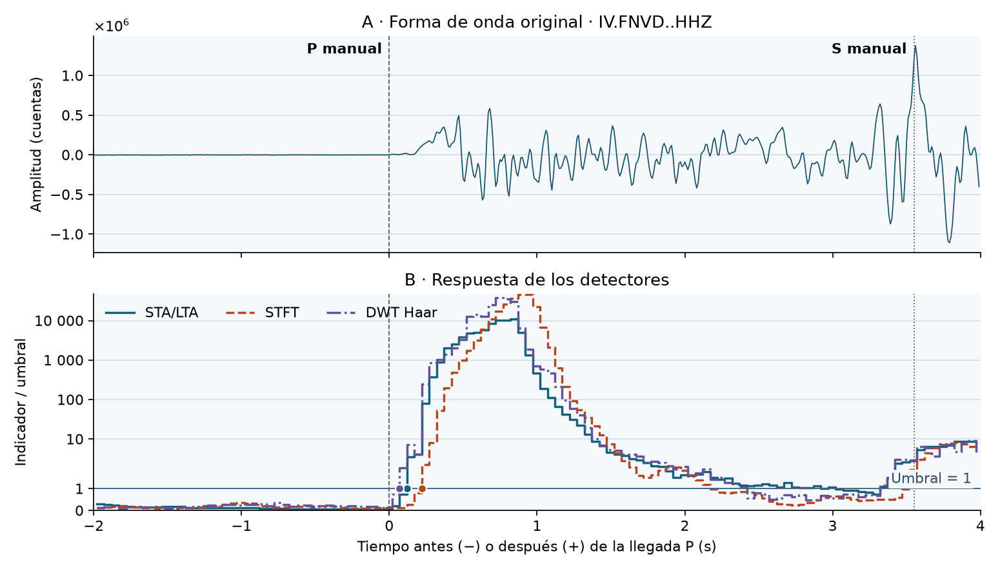

# Seismic Wavelets · edición de revisión

Proyecto de Procesamiento Digital de Señales de Vicente Rojas, Yimmer Sanabria
y Juan David Roa. Compara tres indicadores para detectar la llegada de ondas P
y ofrece funciones para describir transitorios con FFT, STFT, CWT y DWT.

La demostración usa 90 s de la componente vertical de FNVD (INGV) durante el
sismo de Mugello del 9 de diciembre de 2019. Verifica los archivos MiniSEED,
prepara las muestras, calcula los detectores y compara sus disparos con una
llegada P de referencia. Incluye las entradas y funciona **sin conexión** una
vez instaladas las dependencias. La [adquisición FDSN](docs/ADQUISICION.md)
es una ruta opcional, separada de la demo y de las pruebas.



## Instalación y primera ejecución

Usa **CPython 3.14**. Ejecuta los comandos desde la raíz del clon. La primera
instalación requiere acceso a un índice de paquetes o a una copia local de las
ruedas correspondientes. El entorno se crea en `.venv`; no se distribuye un
entorno binario que dependa de la máquina o de la ruta de instalación.

**Linux (Bash):**

```bash
python3.14 -m venv .venv
source scripts/activate.sh
python -m pip install --only-binary=:all: -r requirements.lock
python -m pip install --no-build-isolation --no-deps -e .
python scripts/demo_mugello_beamer.py
```

**Windows (PowerShell):**

```powershell
py -3.14 -m venv .venv
$python = ".\.venv\Scripts\python.exe"
& $python -m pip install --only-binary=:all: -r requirements.windows.lock
& $python -m pip install --no-build-isolation --no-deps -e .
& $python scripts/demo_mugello_beamer.py
```

Si el ejecutable 3.14 tiene otro nombre, usa su ruta explícita al crear `.venv`.
Si Windows no tiene Python 3.14, consulta la [guía Windows](docs/WINDOWS.md):
incluye un intérprete autónomo comprobado por SHA-256 y pasos para VS Code.
Las recetas usan bloqueos por plataforma; para el estado de verificación de
esta edición y las funciones de las dependencias, consulta [Entorno](docs/ENTORNO.md).

## Ver el resultado

Abre `results/mugello/index.html` en el navegador. La página incluye la figura,
la tabla y el procedimiento, sin cargar recursos externos. El mismo comando
acepta `--present` para intentar abrirla automáticamente y `--output DIR` para
elegir otro destino. En automatización, `SEISMIC_DEMO_NO_BROWSER=1` evita lanzar
el navegador. La [figura de ejemplo](examples/mugello/demo_mugello.png) y
[su resultado numérico](examples/mugello/demo.json) muestran una ejecución
de referencia; los tiempos de cómputo varían entre máquinas.

En VS Code, abre `seismic-wavelets-review.code-workspace`. Registra el kernel
con el Python del proyecto: `python scripts/register_kernel.py` (o
`& $python scripts/register_kernel.py` en PowerShell). Abre
[el notebook de Mugello](notebooks/03_demo_mugello.ipynb), selecciona
**Python (seismic-wavelets-review)** comprobando que apunte a la `.venv` de este clon
y ejecuta las celdas en orden. La última genera el HTML con las mismas medidas
que muestra el notebook. La tarea **DSP: Demostración sísmica (Mugello)**
permite abrir el resumen directamente.

## Leer y comprobar el código

- [Guía del código y convenciones numéricas](docs/CODIGO.md).
- [Adquisición opcional](docs/ADQUISICION.md).
- [Procedencia y atribución de Mugello](data/mugello/README.md).
- **Pruebas sin red:** `python -m pytest -q` (Windows: `& $python -m pytest -q`).
  Incluyen casos sintéticos, invariantes de transformadas y peticiones FDSN simuladas.

Esta edición presenta el núcleo, las pruebas y un caso real ejecutable.
La demo evalúa desfases respecto a una P manual en una grabación archivada.

## Licencia

El código propio del proyecto se distribuye bajo la [licencia MIT](LICENSE).
MIT no cubre los datos de Mugello ni otros materiales de terceros. Consulta
la [procedencia, atribución y condiciones de los datos de INGV](data/mugello/README.md).
